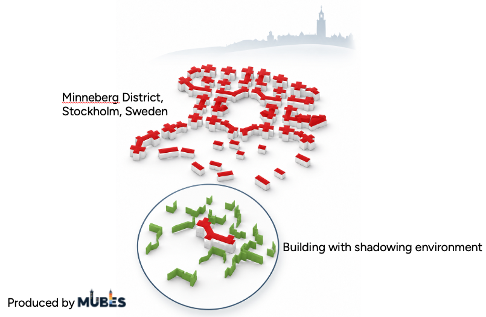

# MUBES UBEM


Massive Area Urban Building Energy Simulation (MUBES) is a tool in framework of Urban Building Energy Modeling (UBEM) that propose a workflow that creates automatic building energy models for EnergyPlus software. 

* All inputs are dealt with an external *.yml file.  
* Several thermal zoning options are proposed from single heated and non heated zones up to core and perimeter zones for each building floor.
* It can launch simulations using parallel computing or can automatically creates FMUs of each building in order to make co-simulation afterward (the co-simulation process, using FMPy, is validated in Windows, Mac and Linux (Ubuntu)).  
* The main input file is in a geojson format. It contains the footprint including height (3D vertexes, or 2D vertexes and height as an attribut) of each building's surface as well as some propreties taken from several databases (EPCs, and others).  
__Rq__:  The platform is continually under development, newcomers are welcome to join by forking and proposing changes.  



<details>
<summary><h2 style="display: inline; margin: 0;">Environments</h2></summary>

MUBES is a Python-based urban building energy modelling tool that uses EnergyPlus as its simulation engine. The Docker setup runs MUBES with Python 3.9 and EnergyPlus 9.5, so users do not need to install those versions separately. 
MUBES uses [EPPY]([EPPY](https://github.com/santoshphilip/eppy)) and [GeomEppy]([GeomEppy](https://github.com/jamiebull1/geomeppy)). Earlier versions were also tested directly on Windows, Ubuntu 20.04, and macOS with various Python and EnergyPlus versions.

</details>

<details>
<summary><h2 style="display: inline; margin: 0;">Installation process</h2></summary>

<details>
<summary><h3 style="display: inline; margin: 0;">Run with Docker</h3></summary>

Install Docker Desktop and clone this repository. From the project folder, build the image:

```bash
docker compose build
```

Place the required `.epw` weather file in `docker-inputs/WeatherData/` and `Minimal.idf` in `docker-inputs/ExampleFiles/`. These folders are not included in the repository.

Run MUBES:

```bash
docker compose run --rm mubes
```

</details>

<details>
<summary><h3 style="display: inline; margin: 0;">Install directly</h3></summary>

Install compatible versions of Python and EnergyPlus, then install the Python packages:

```bash
pip install -r requirements.txt
```

The GeomEppy dependency uses a branch derived from the original package.

</details>

<details>
<summary><h3 style="display: inline; margin: 0;">FMU creation</h3></summary>

The FMU creation option requires the [EnergyPlusToFMU-v3.1.0 toolkit](https://simulationresearch.lbl.gov/fmu/EnergyPlus/export/userGuide/download.html). Install it alongside the MUBES project in a folder named `FMUsKit`.

FMUs can be moved to another computer when they do not use external files. Relative paths to external files currently cause errors. On Windows 10, see [EnergyPlusToFMU issue 54](https://github.com/lbl-srg/EnergyPlusToFMU/issues/54) for the timing changes needed to remove intermediate files.

</details>

</details>

<details>
<summary><h2 style="display: inline; margin: 0;">Folder organization</h2></summary>

The main MUBES folder contains:

- **`bin/`** — Python source code. The main entry point is `bin/mubes_run.py`.
- **`default/`** — Default YAML configuration files and supporting data. You can use `default/config/env.yml` to set paths for your local environment. This folder also contains time series for domestic hot water input temperature and water tap use. The water tap data comes from [StROBe](https://github.com/open-ideas/StROBe), which generates stochastic residential occupancy data.
- **`examples/`** — Example YAML configurations and case data. Check the paths and required input files in an example before running it; some example inputs are not included in the repository.
- **`Dockerfile`** — Defines the Docker image with Python, EnergyPlus, and the required Python packages.
- **`compose.yaml`** — Defines how to run MUBES in Docker and where input and result folders are mounted.
- **`docker-inputs/`** — Local files supplied to the container, including weather files in `WeatherData/` and `Minimal.idf` in `ExampleFiles/`. This folder is not included in Git.
- **`docker-results/`** — Results written by Docker runs. This folder is not included in Git.

To run an example configuration with Docker, pass its YAML file to `mubes_run.py`:

```bash
docker compose run --rm mubes python -u mubes_run.py -yml /project/examples/ExampleName.yml
```

Replace `ExampleName.yml` with the example you want to run, after checking that its required input files are available.

</details>

<details>
<summary><h2 style="display: inline; margin: 0;">Run a simulation case</h2></summary>

MUBES reads `default/config/DefaultConfig.yml` first. An optional YAML configuration can change only the settings you want to override. If you run MUBES directly, check the EnergyPlus and data paths in `default/config/env.yml` before starting.

<details>
<summary><h3 style="display: inline; margin: 0;">Run with Docker</h3></summary>

From the project folder, run the default configuration:

```bash
docker compose run --rm mubes
```

To use a specific YAML configuration:

```bash
docker compose run --rm mubes python -u mubes_run.py -yml /project/path/to/config.yml
```

Replace `/project/path/to/config.yml` with the file’s path **inside the container**. For example, a configuration stored at `examples/MyCase.yml` in the project has the container path `/project/examples/MyCase.yml`.

Before running a simulation, provide the weather file required by your configuration in `docker-inputs/WeatherData/` and `Minimal.idf` in `docker-inputs/ExampleFiles/`. Also check that any data files referenced by the configuration are available.

</details>

<details>
<summary><h3 style="display: inline; margin: 0;">Run directly with Python</h3></summary>

From the `bin/` folder, run the default configuration:

```bash
python mubes_run.py
```

To use a specific YAML configuration:

```bash
python mubes_run.py -yml path_to_config.yml
```

The YAML file can contain only the settings you want to change from `DefaultConfig.yml`.

MUBES also accepts configuration values as a JSON argument:

```bash
python mubes_run.py -CONFIG '{"0_APP":{"PATH_TO_RESULTS":"../examples"}}'
```

The JSON can contain only the settings you want to change from `DefaultConfig.yml`.

</details>

</details>

<details>
<summary><h2 style="display: inline; margin: 0;">Retrofitting studies</h2></summary>

! The tool is under development for retrofit studies. It has been tried to separate the retrofit studies with already developed repository.

Run a retrofitting scenario:
1. Put *__Retrofit : True__* in *__DefaultConfig.yml__* under *__2_CASE/1_SimChoices/Retrofit__*.
2. Building UUID to be retrofitted should be defined in *__RetrofitConfig.yml__* and note that the selected building have to exist in *__DefaultConfig.yml__* or other scenario. If no BldID given to RetrofitConfig, then all buildings in scenarion config will be retrofitted.
3. *__python__ __mubes_run.py__ __-yml__ __path_to_config.yml__ __path_to_RetrofitConfig.yml__* The RetrofitConfig file follows the same structure as DefaultConfig, with some modifications.

__External study__: If you want to run simulation for some hypothetical building, there is a need for a specific input data structure. So to make that possible there is an option in Config file under *__2_CASE/1_SimChoices/ExternalStudy__* that you should put it True. The properties of your desired building should be defined in *__UserManualInput.yml__* under *__default/data/Basic__*.

___
Examples are given in the __examples__ folder, just launch each example using the wording above with the path to each yml example file.  

__Note__ : *ConfigFile.yml* are systematically saved in the result folder and can thus be used afterward with the *-yml* argument

__Outputs_Template.txt__  in __bin\outputs__ : This file proposes a list of available outputs from EP. It has been build from a .rdd file from EP. The required outputs should be indicated in this file. It also indicates at which frequency the modeler wants his outputs.  

</details>

<details>
<summary><h2 style="display: inline; margin: 0;">Creating a shadowing wall file</h2></summary>

* *__python__ __MakeShadowingWallFile.py__* will build a .json file out of the geojson files in the same location, given in the *Config.yml*.  
* *__python__ __MakeShadowingWallFile.py__ __-yml__ __path_to_config.yml__* will build a .json file out of the geojson files in the same location, given in the *path_to_config.yml*.  
* *__python__ __MakeShadowingWallFile.py__ __-geojson__ __path_to_geojson.geojson__* will build a .json file out of the geojson files in the same location.  
* Extra argument can be given to choose shadowing resolution with simple neighborhood, extended neighborhood (higher buildings are considered even if behind others), and all surfaces from all buildings.

Example:
* __python MakeShadowingWallFile.py__ __-geojson Stockholm.geojson__ __-ShadeLimits SimpleSurf__
* __python MakeShadowingWallFile.py__ __-geojson Stockholm.geojson__ __-ShadeLimits AllSurf__

The more shadowing walls are considered the more warnings can be raised by EnergyPlus afterward.  

</details>

<details>
<summary><h2 style="display: inline; margin: 0;">FMU examples</h2></summary>

* __FMPySimPlayGroundEx1.py__ and __FMPySimPlayGroundEx2.py__: it uses FMPy package and as been successfully tested for controlling temperature's setpoints, internal loads, or watertaps at each time steps of the simulation. For one who'd like to make co-simulation, a deep understanding is still needed on the EP side as inputs and outputs are to be defined.  

FMU construction are realized if *CreateFMU* is set to True in *LocalConfig.yml*. 
The two examples (Ex1 and Ex2) :  
* Ex1 : proposes a simple offset on the temperature setPoints. Every two hours a new building sees its setpoint decreases from 21degC to 18degC. the frequency of changes for each building thus depends on the size of the district that is considered. The internal Loads are also modified depending on working and nonworking hours  
* Ex2 : proposes a couple temperature setpoints and water taps controls for each building, keeping the hourly based internal load inputs. It reads an external file to feed the water taps at each time step, and depending on a threshold of water taps' flow, the temperature's setpoints are changed.  
* *__python__ __FMPySimPlayGroundEx1.py.py__* will load the fmu and launch simulation from CaseName given in the *LocalConfig.yml*.  
* *__python__ __FMPySimPlayGroundEx1.py__ __-yml__ __path_to_config.yml__* will load the fmu and launch simulation from CaseName given in the *path_to_config.yml*.  
* *__python__ __FMPySimPlayGroundEx1.py__ __-Case__ __CaseName__* will load the fmu and launch simulation from CaseName.  

</details>

<details>
<summary><h2 style="display: inline; margin: 0;">Engine structure</h2></summary>

The paradigm of simulation engine is to automate simulation on several different levels :
- simulation level (deals with simulation's parameters),
- building level (deals with geometry, envelope and material),
- zone level (deals with internal loads, HVAC and all elements needed at the zone level),
- output level (deals with outpouts variables and frequency).

</details>

## Credits

This work is developed within KTH/SEED/RIE/Urban Team, funded by MUBES' project.  
It has been developed with passion and is still in progress with passion.  
Hope you'll enjoy :) !


## Citation

* Faure, X.; Johansson, T.; Pasichnyi, O. The Impact of Detail, Shadowing and Thermal Zoning Levels on Urban Building Energy Modelling (UBEM) on a District Scale. Energies 2022, 15, 1525. https://doi.org/10.3390/en15041525  
* Faure, X.; Lebrun, R.; Pasichnyi, O. Impact of time resolution on estimation of energy savings using a copula-based calibration in UBEM. Energy and Buildings 2024, Volume 311, 2024, 114134, ISSN 0378-7788. https://doi.org/10.1016/j.enbuild.2024.114134  


